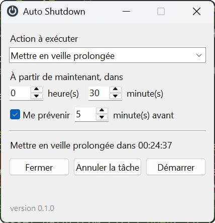
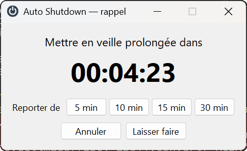
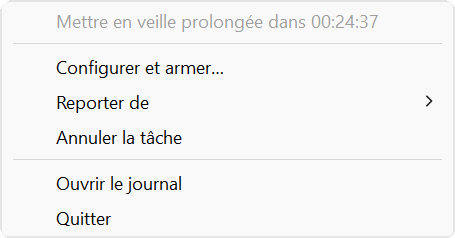

<p align="center">
  
</p>

<h1 align="center">Auto Shutdown</h1>

<p align="center">
  Veille, veille prolongée, arrêt ou verrouillage différé sous Windows —<br>
  <strong>sans redéclenchement intempestif au retour de veille.</strong>
</p>

<p align="center">
  
  
  
  
</p>

<p align="center">
  
  &nbsp;&nbsp;
  
</p>

Beaucoup d'utilitaires de ce genre relancent leur action au retour de veille et
renvoient la machine dormir quelques secondes après chaque réveil. Celui-ci est
conçu pour que cela n'arrive pas.

- ⏱️ **Six actions** : veille prolongée, veille, arrêt, redémarrage, fermeture de
  session, verrouillage.
- 🔔 **Rappel avant l'échéance**, avec annulation ou report de 5 à 30 minutes.
- 🛡️ **Fiable après une veille** : base de temps monotone, désarmement à la
  reprise, détection des décomptes interrompus
  ([détails](docs/fiabilite.md)).
- 📋 **Journal horodaté** de chaque armement, annulation et transition
  d'alimentation.
- 🪶 **Aucune dépendance d'exécution** — `ctypes` et `tkinter` suffisent ;
  exécutable autonome d'environ 12 Mo.

## Installation

```console
> git clone https://github.com/vdidon/auto-shutdown.git auto_shutdown
> cd auto_shutdown
> uv sync
> uv run auto-shutdown
```

## Exécutable autonome

```console
> .\build.ps1
```

Le script régénère l'icône, puis assemble `dist\auto-shutdown.exe` — environ
12 Mo, sans console, ne dépendant d'aucun Python installé sur la machine cible.

```console
> .\build.ps1 -OneDir
```

Produit un dossier plutôt qu'un fichier unique. Le démarrage est nettement plus
rapide : en `--onefile`, le bootloader réextrait l'archive dans `%TEMP%` à chaque
lancement. Pour un programme lancé une fois par session, le fichier unique reste
le plus pratique ; `-OneDir` vaut le détour si le délai gêne.

L'icône est produite par `tools/make_ico.py`, en Python pur, sans Pillow : un
disque ardoise portant le symbole de mise en marche, décliné en 16, 32, 48 et
256 pixels. Le fichier `assets/auto-shutdown.ico` est versionné, la construction
n'a donc pas besoin de l'outil. Il sert à la fois d'icône de l'exécutable et
d'icône des fenêtres.

### Lancement au démarrage de la session

Placer un raccourci vers l'exécutable dans le dossier de démarrage, que l'on
ouvre par `Win+R` puis `shell:startup`. En PowerShell :

```powershell
$lien = "$env:APPDATA\Microsoft\Windows\Start Menu\Programs\Startup\Auto Shutdown.lnk"
$s = (New-Object -ComObject WScript.Shell).CreateShortcut($lien)
$s.TargetPath = (Resolve-Path .\dist\auto-shutdown.exe).Path
$s.Arguments = '--minimized'
$s.Save()
```

`--minimized` est important ici : sans lui, la fenêtre de configuration
s'ouvrirait à chaque ouverture de session. Avec, le programme se contente de
rejoindre la zone de notification.

Une seule instance peut tourner à la fois : un mutex nommé fait échouer le second
lancement avec le code de retour 2, sans fenêtre d'erreur.

### Options

| Option | Effet |
|---|---|
| `--minimized` | démarre sans ouvrir la fenêtre de configuration |
| `--verbose` | journalisation détaillée, également sur la console |
| `--version` | affiche le numéro de version et quitte |

## Utilisation

Au lancement, la fenêtre de configuration s'ouvre — sauf avec `--minimized`. Sa
fermeture n'arrête pas le programme : celui-ci continue de vivre dans la zone de
notification, et l'entrée `Quitter` du menu contextuel est le seul moyen d'y
mettre fin.

Le numéro de version est rappelé en bas de la fenêtre de configuration, afin de
lever toute ambiguïté sur ce qui tourne réellement — sources ou exécutable.

La couleur de l'icône donne l'état d'un coup d'œil :

| Icône | Couleur | État |
|:---:|---|---|
|  | Gris-bleu | aucune tâche programmée |
|  | Orange | tâche armée, décompte en cours |
|  | Rouge | échéance proche, rappel affiché |

- **Clic gauche** ouvre la fenêtre de configuration : action, délai, rappel.
- **Clic droit** ouvre le menu : reporter, annuler, ouvrir le journal, quitter.

<p align="center">
  
</p>

Le rappel s'affiche l'avance choisie avant l'échéance et propose d'annuler, de
laisser faire, ou de reporter de **5, 10, 15 ou 30 minutes**. Le sous-menu
`Reporter de` du clic droit offre les mêmes durées, y compris avant que le
rappel ne se déclenche.

Un report reconduit le rappel avec la même avance, sauf si celle-ci ne tient
plus dans le nouveau délai : reporter de 5 minutes avec un rappel réglé à
5 minutes le ferait tomber sur-le-champ, il est donc simplement omis.

Les durées proposées sont définies à un seul endroit, `POSTPONE_CHOICES` dans
`config.py` ; les deux interfaces s'y alimentent.

### Actions disponibles

`Mettre en veille prolongée` · `Mettre en veille` · `Arrêter` · `Redémarrer` ·
`Fermer la session` · `Verrouiller l'écran`

### Journal

Chaque armement, annulation, déclenchement et transition d'alimentation est
horodaté dans :

```
%LOCALAPPDATA%\auto-shutdown\auto-shutdown.log
```

C'est ce qui permet de répondre après coup à la question que les utilitaires de
ce genre laissent en général sans réponse : *qu'est-ce qui a endormi la machine,
et à quelle heure ?* Le menu du tray l'ouvre directement.

### Configuration

Les réglages sont dans `%APPDATA%\auto-shutdown\config.json`, modifiable à la
main. Un fichier corrompu ou incomplet n'empêche jamais le démarrage : les
valeurs manquantes retombent sur leurs défauts.

| Clé | Défaut | Rôle |
|---|---|---|
| `action` | `HIBERNATE` | action exécutée à l'échéance |
| `delay_minutes` | `30` | délai depuis l'armement |
| `reminder_enabled` | `true` | affichage du rappel |
| `reminder_minutes` | `5` | avance du rappel |
| `input_quiet_seconds` | `3.0` | calme d'entrée exigé avant de suspendre |
| `input_quiet_timeout` | `30.0` | plafond d'attente de ce calme |
| `stall_threshold_seconds` | `60.0` | seuil de détection d'un décompte interrompu |

## Architecture

```
src/auto_shutdown/
├── winapi.py     liaison ctypes : fenêtres, zone de notification, alimentation
├── power.py      actions et précautions qui les entourent
├── scheduler.py  décompte, échéance, règles de fiabilité
├── tray.py       icône, menu, boucle de messages Windows
├── ui.py         fenêtres tkinter : configuration et rappel
├── config.py     réglages persistés
├── log.py        journal tournant
└── app.py        assemblage et threads

assets/          icône versionnée
docs/images/     captures d'écran du README
tools/           génération de l'icône et des captures
launcher.py      point d'entrée pour PyInstaller
build.ps1        construction de l'exécutable
```

Trois threads : la boucle tkinter dans le thread principal, la boucle de
messages Windows dans un thread dédié, le décompte dans un troisième. Tout ce
qui touche à tkinter est réacheminé vers le thread principal ; les deux autres
composants acceptent d'être sollicités depuis n'importe quel thread.

Une seule fenêtre reçoit à la fois les événements de la zone de notification et
les notifications d'alimentation, ce qui supprime tout besoin de synchronisation
entre les deux.

## Versionnage

Le projet suit le [versionnage sémantique](https://semver.org/lang/fr/)
`MAJEUR.MINEUR.CORRECTIF`. Les évolutions sont consignées dans
[CHANGELOG.md](CHANGELOG.md), qui détaille aussi ce que recouvre chaque rang.

Le numéro vit à un seul endroit qui fasse foi à l'exécution,
`src/auto_shutdown/__init__.py`, car les métadonnées d'installation ne sont pas
lisibles depuis un exécutable PyInstaller. `pyproject.toml` porte nécessairement
la même valeur pour la distribution : un test refuse que les deux divergent, et
exige une entrée au journal des modifications pour la version courante.

Publier une version se résume donc à modifier `__version__`, reporter la valeur
dans `pyproject.toml`, ajouter la section correspondante au journal, puis
reconstruire.

## Développement

```console
> uv sync --all-groups
> uv run pytest          # suite de tests
> uv run ruff check .    # analyse statique
> uv run ruff format .   # formatage
```

Les tests pilotent l'ordonnanceur avec une horloge simulée et un exécuteur de
remplacement : la suite complète s'exécute en une fraction de seconde, sans
jamais endormir la machine. Les scénarios reproduisent les enchaînements relevés
dans le journal Windows (voir [docs/fiabilite.md](docs/fiabilite.md)).

Les captures du README sont produites à partir des vraies fenêtres, alimentées
par un état simulé. Après une modification de l'interface :

```console
> uv run --with pillow python tools/screenshots.py
```

Ne pas toucher à la souris pendant l'exécution : le script ouvre le menu
contextuel sous le pointeur.

## Licence

MIT.
