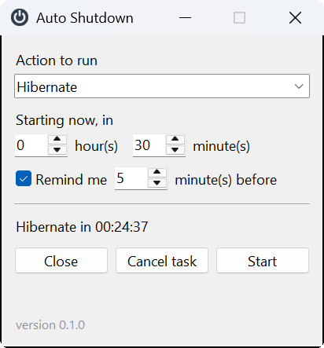
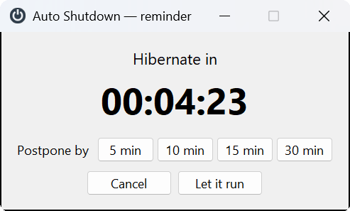
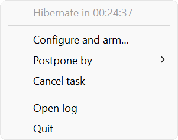

<p align="center">
  
</p>

<h1 align="center">Auto Shutdown</h1>

<p align="center">
  Delayed sleep, hibernation, shutdown or lock on Windows —<br>
  <strong>without spurious re-triggering when the machine resumes from sleep.</strong>
</p>

<p align="center">
  <a href="https://github.com/vdidon/auto-shutdown/releases/latest"></a>
  
  
  
  
</p>

<p align="center">
  
  &nbsp;&nbsp;
  
</p>

Many utilities of this kind run their action again when the machine resumes from
sleep, sending it back to sleep a few seconds after every wake-up. This one is
designed so that it cannot happen.

- ⏱️ **Six actions**: hibernate, sleep, shut down, restart, sign out, lock.
- 🔔 **Reminder before the deadline**, with the choice to cancel or postpone by 5
  to 30 minutes.
- 🛡️ **Reliable across sleep**: monotonic time base, disarming on resume,
  detection of interrupted countdowns
  ([details](docs/reliability.md)).
- 📋 **Timestamped log** of every arming, cancellation and power transition.
- 🪶 **Nothing to install** — a single portable executable of about 12 MB, no
  Python required.

<p align="center">
  <a href="https://github.com/vdidon/auto-shutdown/releases/latest/download/auto-shutdown.exe"><strong>⬇️ Download auto-shutdown.exe</strong></a>
  &nbsp;·&nbsp;
  <a href="https://github.com/vdidon/auto-shutdown/releases">All releases</a>
</p>

## Installation

1. Download `auto-shutdown.exe` from the
   [latest release](https://github.com/vdidon/auto-shutdown/releases/latest).
2. Put it wherever you like, for instance in
   `%LOCALAPPDATA%\Programs\auto-shutdown\`. There is no installer: the
   executable is the whole program.
3. Run it.

The executable is not code-signed, so on first launch Windows SmartScreen may
show *Windows protected your PC*: choose **More info**, then **Run anyway**.
For the same reason, some antivirus products flag executables built with
PyInstaller; the [source](#building-from-source) and the build script are here
to check what it contains.

### Launching at sign-in

Put a shortcut to the executable in the startup folder, which you open with
`Win+R` then `shell:startup`. In PowerShell, adjusting the path to where you
saved the executable:

```powershell
$exe  = "$env:LOCALAPPDATA\Programs\auto-shutdown\auto-shutdown.exe"
$link = "$env:APPDATA\Microsoft\Windows\Start Menu\Programs\Startup\Auto Shutdown.lnk"
$s = (New-Object -ComObject WScript.Shell).CreateShortcut($link)
$s.TargetPath = $exe
$s.Arguments = '--minimized'
$s.Save()
```

`--minimized` matters here: without it, the configuration window would open at
every sign-in. With it, the program simply joins the notification area.

Only one instance can run at a time: a named mutex makes a second launch fail
with exit code 2, without an error window.

### Options

| Option | Effect |
|---|---|
| `--minimized` | starts without opening the configuration window |
| `--verbose` | detailed logging, also on the console |
| `--version` | prints the version number and exits |

### Uninstalling

Quit the program from its tray menu, then delete the executable, the startup
shortcut if you created one, and the two data folders:

```
%APPDATA%\auto-shutdown          settings
%LOCALAPPDATA%\auto-shutdown     log
```

## Usage

At launch, the configuration window opens — unless `--minimized` is given.
Closing it does not stop the program: it keeps living in the notification area,
and the `Quit` entry of the context menu is the only way to end it.

The version number is shown at the bottom of the configuration window, to remove
any ambiguity about what is actually running — sources or executable.

The icon color gives the state at a glance:

| Icon | Color | State |
|:---:|---|---|
|  | Blue-gray | no task scheduled |
|  | Orange | task armed, countdown running |
|  | Red | deadline close, reminder shown |

- **Left click** opens the configuration window: action, delay, reminder.
- **Right click** opens the menu: postpone, cancel, open the log, quit.

<p align="center">
  
</p>

The reminder appears the chosen lead time before the deadline and offers to
cancel, to let it run, or to postpone by **5, 10, 15 or 30 minutes**. The
`Postpone by` submenu of the right-click menu offers the same durations, even
before the reminder fires.

A postponement renews the reminder with the same lead time, unless that no
longer fits in the new delay: postponing by 5 minutes with a reminder set to 5
minutes would make it fire on the spot, so it is simply skipped.

The offered durations are defined in a single place, `POSTPONE_CHOICES` in
`config.py`; both interfaces draw from it.

### Available actions

`Hibernate` · `Sleep` · `Shut down` · `Restart` · `Sign out` · `Lock the screen`

### Languages

The interface follows the Windows display language: the first supported
language among the user's preferred display languages (Settings > Time &
language). English and French are currently available; anything else falls back
to English. Logs, command-line help and error messages are always in English.

To add a language, create `src/auto_shutdown/locales/<code>.py` with a
`MESSAGES` dict that has the same keys as `locales/en.py`, then register it in
`CATALOGS` in `src/auto_shutdown/i18n.py`. `tests/test_i18n.py` checks that the
keys and placeholders match.

### Log

Every arming, cancellation, trigger and power transition is timestamped in:

```
%LOCALAPPDATA%\auto-shutdown\auto-shutdown.log
```

This is what makes it possible to answer, after the fact, the question these
utilities usually leave unanswered: *what put the machine to sleep, and at what
time?* The tray menu opens it directly.

### Configuration

Settings are in `%APPDATA%\auto-shutdown\config.json`, which can be edited by
hand. A corrupted or incomplete file never prevents startup: missing values fall
back to their defaults.

| Key | Default | Role |
|---|---|---|
| `action` | `HIBERNATE` | action run at the deadline |
| `delay_minutes` | `30` | delay since arming |
| `reminder_enabled` | `true` | whether the reminder is shown |
| `reminder_minutes` | `5` | reminder lead time |
| `input_quiet_seconds` | `3.0` | input quiet period required before suspending |
| `input_quiet_timeout` | `30.0` | cap on the wait for that quiet period |
| `stall_threshold_seconds` | `60.0` | threshold for detecting an interrupted countdown |

## Building from source

Requires Python 3.13 and [uv](https://docs.astral.sh/uv/).

```console
> git clone https://github.com/vdidon/auto-shutdown.git
> cd auto-shutdown
> uv sync
> uv run auto-shutdown
```

To build the executable:

```console
> .\build.ps1
```

The script regenerates the icon, then builds `dist\auto-shutdown.exe` — about
12 MB, no console, and independent of any Python installed on the target
machine.

```console
> .\build.ps1 -OneDir
```

Produces a folder instead of a single file. Startup is noticeably faster: with
`--onefile`, the bootloader re-extracts the archive into `%TEMP%` on every
launch. For a program started once per session, the single file remains the most
convenient; `-OneDir` is worth it if the delay is a nuisance.

The icon is produced by `tools/make_ico.py`, in pure Python, without Pillow: a
slate disc bearing the power symbol, in 16, 32, 48 and 256 pixel sizes. The
`assets/auto-shutdown.ico` file is versioned, so the build does not need the
tool. It serves both as the executable's icon and as the windows' icon.

## Architecture

```
src/auto_shutdown/
├── winapi.py     ctypes binding: windows, notification area, power
├── power.py      actions and the precautions around them
├── scheduler.py  countdown, deadline, reliability rules
├── tray.py       icon, menu, Windows message loop
├── ui.py         tkinter windows: configuration and reminder
├── config.py     persisted settings
├── i18n.py       interface language detection and translation lookup
├── locales/      one text catalog per language
├── log.py        rotating log
└── app.py        wiring and threads

assets/          versioned icon
docs/images/     README screenshots
tools/           icon and screenshot generation
launcher.py      entry point for PyInstaller
build.ps1        executable build
```

Three threads: the tkinter loop in the main thread, the Windows message loop in
a dedicated thread, the countdown in a third. Everything that touches tkinter is
rerouted to the main thread; the other two components accept being called from
any thread.

A single window receives both the notification-area events and the power
notifications, which removes any need for synchronization between the two.

## Versioning

The project follows [Semantic Versioning](https://semver.org/)
`MAJOR.MINOR.PATCH`. Changes are recorded in [CHANGELOG.md](CHANGELOG.md), which
also details what each rank covers.

The number lives in a single place that is authoritative at runtime,
`src/auto_shutdown/__init__.py`, because installation metadata is not readable
from a PyInstaller executable. `pyproject.toml` necessarily carries the same
value for the distribution: a test refuses to let the two diverge, and requires
a changelog entry for the current version.

Publishing a release:

1. change `__version__`, copy the value into `pyproject.toml`, and add the
   matching section to the changelog;
2. rebuild with `.\build.ps1`;
3. tag and publish, attaching the executable under its plain name — the
   download link at the top of this page points to
   `releases/latest/download/auto-shutdown.exe`, so a versioned file name
   would break it:

```console
> git tag v0.1.0
> git push origin main v0.1.0
> gh release create v0.1.0 dist\auto-shutdown.exe --title "v0.1.0" --notes-file <notes>
```

## Development

```console
> uv sync --all-groups
> uv run pytest          # test suite
> uv run ruff check .    # static analysis
> uv run ruff format .   # formatting
```

The tests drive the scheduler with a simulated clock and a stand-in executor:
the whole suite runs in a fraction of a second, without ever putting the machine
to sleep. The scenarios reproduce the sequences found in the Windows event log
(see [docs/reliability.md](docs/reliability.md)).

The README screenshots are produced from the real windows, fed with a simulated
state. After changing the interface:

```console
> uv run --with pillow python tools/screenshots.py
```

This captures in English by default; `--language fr` captures the French
interface instead.

Do not touch the mouse while it runs: the script opens the context menu under
the pointer.

## License

MIT.
